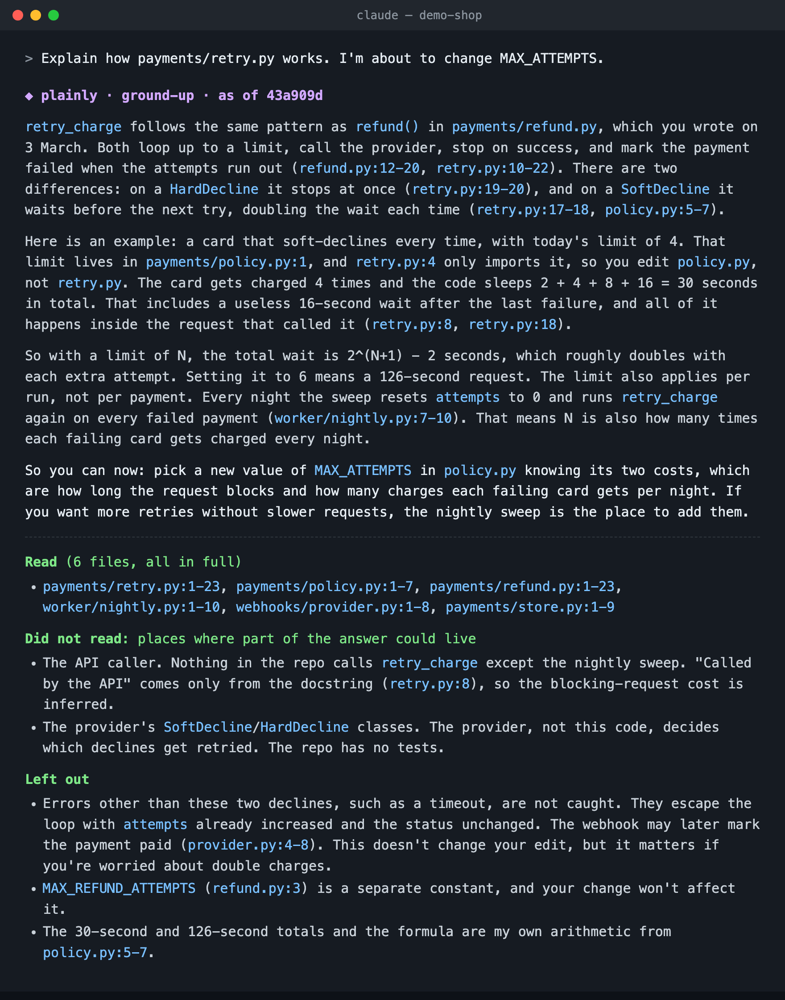

# plainly

**Explains it simply — and shows you what it left out.**



<sub>A real answer, unedited. Rebuild the demo repo with `evals/make-demo-repo.sh` and ask the same question.</sub>

A Claude Code plugin for explanations that fit the person reading them.

- **Starts from what you know.** It keeps a small profile of what you're expert
  in and what you're new to — per domain, because nobody is "technical" or
  "non-technical" across the board. Then it explains the new thing in terms of
  something you already understand.
- **Says what it left out.** Every simplification drops things, and studies of
  AI plain-language summaries found nearly a third added at least one claim
  not in the source. plainly ends every explanation with a short receipt: what it
  dropped that matters, what it bent, what it added.
- **Doesn't drift.** You shouldn't have to say "explain it simply" every
  session. A 70-word reminder rides along with every prompt, so the style holds
  in long conversations.
- **In code, cites everything.** Claims carry `file:line`, the answer is pinned
  to a commit, and it lists the places it *didn't* read. If you've committed to
  the repo, it anchors on code you wrote.

## What you get

Ask a normal question. Get a normal answer — prose, not a diagram.

Here the reader is a head chef who is new to software. Their profile says so
in three lines, and that changes everything about the answer:

```
# Expert in
- running a restaurant kitchen (head chef, 12 years)
# New to
- software and how web apps work
```

They ask: *"My developer keeps saying we need a message queue for online
orders. What is that?"*

> ◆ plainly · ground-up
>
> You already use a message queue: your ticket rail. When a server rings in an order, they don't stand at the pass waiting for the food. They clip the ticket on the rail and go back to the floor, and each station pulls tickets in order when it's ready.
>
> In software, a message queue does the same job. Say 200 online orders arrive between 7 and 8 on a Friday night. Without a queue, the website has to pass each order straight to the kitchen screen, the card payment, and the receipt email, all at once. If any of those is slow or down, the customer gets an error and the order can be lost. With a queue, the website clips each order onto the rail in a split second and tells the customer "order received." The other systems then work through the orders at their own pace.
>
> The key rule is that the queue holds each order until something confirms it was handled. So if the kitchen printer jams or payments are slow, orders wait instead of disappearing. Your developer is probably raising this because orders are getting dropped, or the site slows down, during rushes. That's the problem a queue fixes.
>
> Next layer: what a queue costs to run, and what can still go wrong, such as the same order being sent to the kitchen twice.
>
> So you can now: ask your developer whether orders have actually been lost during busy times, and how many. That number tells you whether a queue is worth paying for now or can wait.
>
> ---
>
> **What I left out**
> - **Cost and effort:** a queue is one more piece of software to set up, pay for, and watch. It's not free insurance.
> - **Where the comparison breaks down:** a real ticket rail is one line that everyone reads. A software queue can send copies of the same order to several systems, like the kitchen, payments, and email, which a paper ticket can't do.
> - **What I assumed:** I guessed your developer's reason. They may be thinking ahead about growth rather than fixing a problem you have today.

<sub>A real answer, unedited.</sub>

## Install

Needs Claude Code and Node.js 18+ on your `PATH` (the always-on part is two small Node hooks).

```
/plugin marketplace add munshi007/plainly
/plugin install plainly@plainly
```

Or try it locally without installing:

```
git clone https://github.com/munshi007/plainly && claude --plugin-dir ./plainly
```

Then say **`plainly setup`** to make your reader profile (three questions, under
two minutes). It's a plain Markdown file at `~/.config/plainly/reader.md` that
you own and can edit — see [`templates/reader.md`](templates/reader.md). Nothing
leaves your machine.

## Modes

| Mode | For | Feels like |
|---|---|---|
| `ground-up` (default) | smart, new to this domain | short sentences, one worked example |
| `bridge` | expert next door | "it's like X, except where it isn't" |
| `peer` | fluent in the domain | keeps the jargon, cuts the basics |
| `kid` | an actual child | toys and playgrounds; receipt is for the grown-up |

Switch for the session: `/plainly peer`, `plainly mode bridge`, `plainly off`,
`plainly on`. Or just say "too basic" / "you lost me". Set the default in your
profile.

Depth is also chosen per topic: if your profile says you're new to Kubernetes,
you get `ground-up` for Kubernetes even when your default is `peer`.

## Share cards

Ask for "a card" and you get a compressed three-column version for a README or
Slack. Never by default — a card as the answer to a question is a gimmick.

## Using it without the plugin

Copy `skills/plainly/` into `~/.claude/skills/`, and paste
[`fragment/CLAUDE.md`](fragment/CLAUDE.md) into your `CLAUDE.md` for the
always-on part. You lose the per-turn reminder and mode switching.

## What it doesn't do

- **No readability scores.** They measure word length, not understanding, and
  they're easy to game. The test is whether the answer ends with something you
  can now do or decide.
- **No retrieval.** In code, it uses whatever search your session already has.
  The receipt shows you what that search did and didn't cover.
- **No diagrams.** Use a dedicated renderer (e.g.
  [visual-explainer](https://github.com/djenriquez/visual-explainer)) — plainly
  composes with it.
- **No whole-codebase tours.** "Explain the repo" gets a polite refusal and two
  or three task-sized questions instead.

## Known interactions

The per-prompt reminder is 70 words (about 390 characters) and fires on
**every** prompt, including "run the tests and push". It says "if this turn
explains something", and the model decides whether it applies. On turns that
explain nothing it changes nothing, but it still costs those tokens.
`plainly off` stops it for the session.

Plugins that compress Claude's chat style (e.g. caveman) also inject per-turn
instructions. plainly tells the model to write explanations in full sentences
regardless; chatter outside explanations follows the other style.

## Why it's built this way

Instruction drift within a handful of turns is measured, not
imagined; "simple" means nothing without knowing the reader; and simplified
summaries routinely add facts that aren't in the source — which existing tools
neither catch nor admit.

## Develop

```
npm test                       # hook unit tests
claude plugin validate .       # manifest + skill checks
claude --plugin-dir .          # try it
node evals/run.js --runs 2     # live format eval (real sessions, costs tokens)
```

The eval checks **format**, not accuracy. It checks for the header, the
"So you can now" line, the receipt, the mode and the length cap. The
document case (`stale-doc`) adds keyword checks: the body names the current
design, keeps the source's "not verified" flag, and doesn't state the old
design as current. Regexes can't tell whether an explanation is right, so a
pass means the shape is right, not the facts. Accuracy is checked by reading
the answers against the source; they're saved to the path the eval prints.
Prompts are in `evals/prompts.json`.

MIT licensed.
